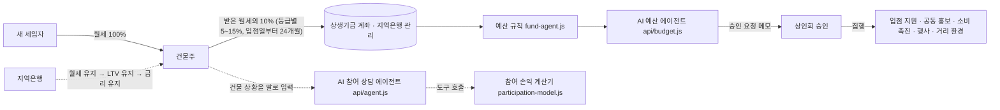

# 자생상권 — 월세는 지키고 공실은 채우는 상생기금 AI

> 2026 대한민국 청년 CAREER FAIR AI 해커톤 · 팀 **청충어람**
>
> 보조금은 끝나면 멈추지만, 월세는 매달 들어옵니다.
> 월세는 그대로 두고, 건물주가 받은 월세의 일부를 **지역은행이 관리하는 상생기금**에 모아
> 빈 점포를 채우는 상생협약을, **AI 에이전트**가 건물주 상담과 기금 예산 운영까지 돕습니다.

| 구분 | 링크 |
|---|---|
| 프로토타입 (실제 작동) | https://chungjang-fund.vercel.app |
| 프로젝트 설명 문서 | [docs/프로젝트_개요.md](docs/프로젝트_개요.md) |

배포 사이트는 로그인 없이 바로 쓸 수 있습니다. 화면의 모든 입력은 가상·샘플 값이며 실제 개인정보는 쓰지 않습니다.

---

## 1. 무엇을 해결하나

- 광주 충장로(금남로/충장로) 중대형 상가 공실률 **26.5%**, 광주 상권 중앙값 12.3%의 약 2배 (R-ONE 2026Q2)
- 13년 치 전국 상권 데이터(R-ONE 359개 상권, 2013Q1~2026Q2) 분석 결과
  - 공실이 늘어도 월세는 잘 내려가지 않음 (공실률 3%p 이상 상승 1,707건 중 67%는 임대가격지수가 1%도 내려가지 않음)
  - 한 번 오른 원도심 공실은 오래 감 (분기 지속성 0.946, 원도심 반감기 약 6.4년)
- 월세 인하 협약은 참여가 낮고(88곳 중 25곳), 보조금 사업은 예산이 끝나면 멈춤

## 2. 서비스 구조



| 화면 (메뉴 순서) | 파일 | 내용 |
|---|---|---|
| 공실 현황 | `index.html` | 카카오맵 공실 추정 지도(소상공인 상가정보 4개 시점 대조), 공실 통계, 데이터 분석 결과 |
| 상생협약 | `agreement.html` | 협약 구조, 1차 대상, 금액 예시, 지역은행 역할 · 금리 유지 |
| **AI 상담** | `agent.html` · `api/agent.js` | 건물주가 말로 적은 건물 상황 → AI가 계산기 · 상권 근거를 불러 판단 · 근거 · 불확실한 점 · 다음 할 일 정리 |
| 참여 조건 계산 | `participation.html` | 비워 둠 / 월세 20% 인하 / 상생협약 참여 3안의 4년 순현금, LTV · 금리, 은행 거래 |
| 상생기금 · 예산 | `fund.html` · `api/budget.js` | 상권 상황별 예산안, 보조금 없이 4기간 운영, **AI 승인 요청 메모** |

## 3. AI 에이전트 동작 방식

두 에이전트 모두 OpenAI `gpt-5.4-mini`의 **도구 호출(function calling)**을 쓰며, 외부 라이브러리 없이 `fetch`만으로 구현했습니다 (`lib/openai-agent.js`의 공통 루프, 최대 6라운드).

| 에이전트 | 서버 함수 | 도구 | 하는 일 |
|---|---|---|---|
| AI 참여 상담 | `api/agent.js` | `calculate_participation` (4년 순현금 · LTV · 손익분기 입점률), `get_market_evidence` (충장로 분석 근거와 출처) | 입점률 가정을 바꿔 계산기를 다시 불러 비교한 뒤 판단을 정리 |
| 예산 메모 | `api/budget.js` | `compute_budget` (항목별 금액 · 배분 근거 · 적립액 · 자생 지표 · 4기간 운영) | 예산 규칙 결과를 인용해 상인회 승인 요청 메모 작성 |

**AI가 틀리지 않게 한 장치**
- 숫자 · 비교 문장 · 판단 등급은 **코드가 만들고**, AI는 그 값을 인용 · 설명만 합니다.
- 화면 아래 **'AI가 한 일'**에 호출한 도구 · 입력값 · 결과를 그대로 공개합니다.
- 응답에 모델명과 "AI 답변은 오류가 있을 수 있으니 위 계산 값을 함께 확인하세요"를 표시합니다.
- 이름 · 연락처 같은 개인정보는 입력하지 말라고 안내하고, 예시 입력은 모두 샘플입니다.
- API 키는 서버 환경변수로만 읽고 브라우저 · 저장소에 두지 않습니다.

## 4. 폴더 구조

```
chungjang-fund/
├─ README.md
├─ docs/프로젝트_개요.md        목적 · 돈의 흐름 · 금리 유지 · 사용법 · 한계
├─ 01_홈페이지/                  배포되는 웹 (Vercel)
│  ├─ index.html · agreement.html · agent.html · participation.html · fund.html
│  ├─ participation-model.js     참여 손익 계산 모델 (AI 도구와 화면이 같은 코드 사용)
│  ├─ participation-ui.js
│  ├─ fund-agent.js              상생기금 예산 규칙
│  ├─ fund-ui.js
│  ├─ api/agent.js               AI 참여 상담 (Vercel 서버 함수)
│  ├─ api/budget.js              AI 예산 메모 (Vercel 서버 함수)
│  ├─ lib/openai-agent.js        도구 호출 공통 루프
│  ├─ test_final.cjs             계산 · 예산 규칙 자동 검증 → 최종검증.json
│  └─ 협약_계산기_수정내역.md     버전별 수정 기록
└─ 02_데이터분석_모델/            R-ONE 수집 · 패널 · 가설 검정 · 공실률 예측 모델 · 분석용 웹앱
   ├─ rone_collect.js · build_panel.py · prepare_v2.py · analysis_rone.py
   ├─ data/                      R-ONE 패널 CSV
   └─ local_web/                 Flask 분석 웹앱 · 모델 서비스 · 테스트
```

## 5. 실행 방법

### 배포 사이트
https://chungjang-fund.vercel.app 에서 바로 사용합니다. (Vercel이 `01_홈페이지`를 배포)

### 로컬에서 AI까지 실행
```bash
cd 01_홈페이지
cp ../.env.example .env.local      # OPENAI_API_KEY 값을 직접 넣습니다 (저장소에 올리지 않음)
npx vercel dev
```

| 환경변수 | 필수 | 설명 |
|---|---|---|
| `OPENAI_API_KEY` | 필수 | OpenAI API 키 (AI 상담 · 예산 메모) |
| `OPENAI_MODEL` | 선택 | 기본 `gpt-5.4-mini` |

AI 없이 화면만 볼 때는 `python -m http.server 8000`으로 열면 됩니다.
카카오맵은 Kakao JavaScript 키(`index.html`의 `KAKAO_KEY`, 등록 도메인에서만 작동하는 공개용 키)를 쓰며, 도메인이 등록되지 않은 환경에서는 위치 안내도로 대신 표시합니다.

### 분석 재현
```bash
cd 02_데이터분석_모델/local_web
python -m pip install -r requirements.txt
python test_services.py
python app.py
```

## 6. 검증

| 대상 | 방법 | 결과 |
|---|---|---|
| 참여 손익 계산 · 예산 규칙 | `node 01_홈페이지/test_final.cjs` | 계산기 144조건 · 예산 규칙 96조건 통과 (`최종검증.json`) |
| 분석 모델 · 서비스 | `python test_services.py`, `python test_kosis.py` | 통과 (`local_web/validation.json`) |
| 기본 예시 (5칸 중 2칸 공실, 월세 136만원, 대출 7.5억) | 계산기 · AI 도구 결과 대조 | 비워 둠 5,907 · 월세 20% 인하 4,995 · 참여 5,744만원 (4년), LTV 59.7% 유지 (인하안 64.9%) |

공실률 예측 모델(Extra Trees)은 "현재 공실률을 그대로 쓰는" 단순 기준보다 MAE가 약 0.66%만 낮아, 서비스에서는 **참고 신호**로만 씁니다.

## 7. 한계

- 상생기금의 공실 감소 효과는 아직 검증 전이며, 시범사업에서 측정할 대상입니다.
- 출자율 · 금리 유지 · 추가 인하 · 은행 마진 · LTV 가산금리는 승인되지 않은 **제안 가정**입니다.
- 공실 지도는 등록정보 기반 추정이라 현장 실측과 다를 수 있습니다.
- 예산 에이전트의 '지금 충장로' 매출 · 유동인구 값은 실제 데이터 연동 전 예시 값입니다.

## 8. 개발 범위

| 구분 | 내용 |
|---|---|
| 해커톤 이전 | KDT 종합프로젝트(2026.10.19~11.04) 결과물: R-ONE 수집 · 패널 · 가설 검정 · 공실률 예측 모델(5종 비교), 홈페이지(공실 지도 · 상생협약 · 참여 계산), 참여 계산기 |
| 해커톤 기간 | 11.18 v5 구조 개편(건물주 출자 구조, LTV 유지에 따른 금리 유지, 월세 인하안 비교, 상생기금 · 예산 페이지와 규칙 기반 예산안), 11.21 AI 참여 상담 에이전트(`api/agent.js`, `agent.html`), 상생기금 예산 에이전트(`api/budget.js`) 실제 작동, AI 상담 흐름 연결 |

## Credits / Licenses

| 구분 | 이름 | 출처 · 라이선스 | 용도 |
|---|---|---|---|
| 오픈소스 · 글꼴 | IBM Plex Sans KR · IBM Plex Mono | [fonts.google.com](https://fonts.google.com) · SIL Open Font License 1.1 | 홈페이지 글꼴 |
| 오픈소스 · 글꼴 | Pretendard (길형진, orioncactus) | [github.com/orioncactus/pretendard](https://github.com/orioncactus/pretendard) · SIL Open Font License 1.1 | 소개서 · 시연영상 글꼴 |
| 오픈소스 | pandas · NumPy · SciPy · statsmodels · scikit-learn | [pypi.org](https://pypi.org) · BSD 3-Clause | 데이터 분석 · 가설 검정 · 예측 모델 |
| 외부 데이터 | 한국부동산원 R-ONE 상업용부동산 임대동향 | [reb.or.kr/r-one](https://www.reb.or.kr/r-one) · R-ONE 서비스 이용약관 · 기준 2013Q1~2026Q2 | 공실 · 임대료 분석 |
| 외부 데이터 | 소상공인시장진흥공단 상가(상권)정보 | [data.go.kr/data/15083033](https://www.data.go.kr/data/15083033/fileData.do) · 이용허락범위 제한 없음 · 기준 2023.03 / 2024.06 / 2025.06 / 2026.06 | 공실 추정 지도 |
| 외부 API | Kakao Maps JavaScript API | [developers.kakao.com](https://developers.kakao.com) · Kakao Developers 이용약관 | 공실 현황 지도 |
| AI 모델 | OpenAI API (gpt-5.4-mini, Chat Completions) | [platform.openai.com](https://platform.openai.com) · OpenAI 이용약관 | AI 참여 상담 `api/agent.js` · 예산 메모 `api/budget.js` |
| AI 개발 도구 | Claude Code · Claude (Anthropic) | [claude.com](https://claude.com) · Anthropic 이용약관 | 코드 · 소개서 · 시연영상 제작 보조 (검증은 팀이 직접) |

## 팀 청충어람

강다빈 · 이슬기 · 이승수 · 최은형(대표)
